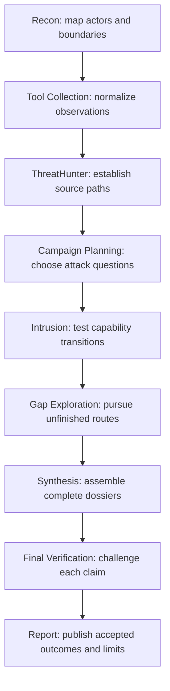
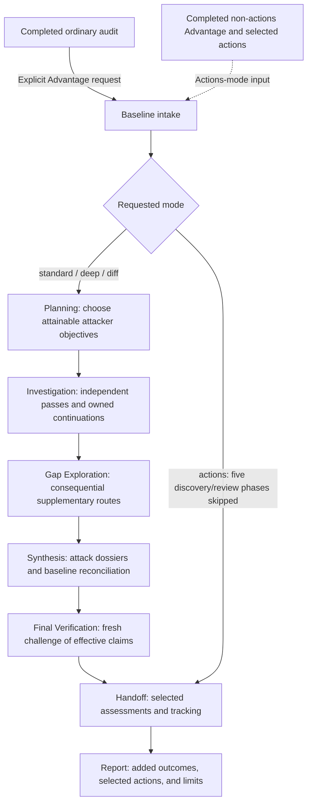

# VulnOps Architecture: From Attacker Access to Proven Impact

VulnOps investigates a concrete question: **what can an attacker make this application do, starting with the access and inputs they actually control?**

The answer is not a scanner count, a graph edge, or a plausible exploit story. It is a source-backed path from starting access through a failed trust decision to a sensitive effect. When that path cannot be established, the result must say which fact is missing, which route was contradicted, and what investigation would resolve the uncertainty.

This document explains how the ordinary audit, informed-attacker Advantage, and separately authorized remediation support that work. It describes the current implementation, not a proposed redesign. [README](README.md) is the product and operator entry point; [AGENTS.md](AGENTS.md) owns execution procedures. Agent prompts own phase behavior, security skills own reusable investigation methods, and deterministic scripts own scheduling, artifact admission, and publication.

## Contents

- [The attack model](#the-attack-model)
- [Three executions, different authority](#three-executions-different-authority)
- [Source scope and trust boundaries](#source-scope-and-trust-boundaries)
- [Ordinary audit flow](#ordinary-audit-flow)
- [Recon: find the doors and the authority](#recon-find-the-doors-and-the-authority)
- [Tool Collection: turn observations into questions](#tool-collection-turn-observations-into-questions)
- [ThreatHunter: establish exploitable source paths](#threathunter-establish-exploitable-source-paths)
- [Campaign Planning and Intrusion: spend capabilities](#campaign-planning-and-intrusion-spend-capabilities)
- [Gap Exploration: pursue consequential unfinished routes](#gap-exploration-pursue-consequential-unfinished-routes)
- [Worked example: from an identifier to another tenant's export](#worked-example-from-an-identifier-to-another-tenants-export)
- [Synthesis: write the complete attack](#synthesis-write-the-complete-attack)
- [Independent verification: try to break the claim](#independent-verification-try-to-break-the-claim)
- [Advantage: investigate with prior intelligence](#advantage-investigate-with-prior-intelligence)
  - [Workflow and phase handoffs](#advantage-workflow-and-phase-handoffs)
  - [Baseline intelligence and attack planning](#baseline-intelligence-and-attack-planning)
  - [Independent passes and continuations](#independent-passes-and-continuations)
  - [Supplementary attack exploration](#supplementary-attack-exploration)
  - [Dossiers and baseline reconciliation](#advantage-dossiers-and-baseline-reconciliation)
  - [Independent review and protected cohorts](#advantage-independent-review-and-protected-cohorts)
  - [Patch views, selected actions, and handoff](#patch-views-selected-actions-and-handoff)
  - [Added outcomes, publication, and fresh invocation](#advantage-outcomes-publication-and-fresh-invocation)
- [Remediation: break the attack without changing the audit](#remediation-break-the-attack-without-changing-the-audit)
- [OMP, agents, and skill ownership](#omp-agents-and-skill-ownership)
- [Optional navigation and contained experiments](#optional-navigation-and-contained-experiments)
- [Continuity, recovery, and failure boundaries](#continuity-recovery-and-failure-boundaries)
- [Reports: attacker outcomes and actionable repairs](#reports-attacker-outcomes-and-actionable-repairs)
- [Evaluation and assurance](#evaluation-and-assurance)
- [Implementation map and change boundaries](#implementation-map-and-change-boundaries)

## The attack model

### An objective is not a finding title

An investigation begins with an actor and a desired effect, not an attack-class label. “Authorization bug” is too broad to assign. “An authenticated tenant can retrieve another tenant's export through a background job” identifies a starting position, a resource boundary, and an outcome that can be challenged.

The architecture separates five concepts:

| Concept | Question it answers | Example |
|---|---|---|
| Objective | What effect is the attacker trying to achieve? | Read another tenant's export. |
| Investigation question | What specific route or proof obligation must be resolved? | Does the worker bind the requested job to the initiating tenant? |
| Observation | What has been seen but not yet established as exploitable? | A job identifier reaches a queue; a dependency version matches an advisory. |
| Capability | What operation can this actor actually perform, over which resources and under what conditions? | Submit an export request containing a chosen job identifier. |
| Finding | Which complete, independently reviewed failure permits an unintended effect? | A proven cross-tenant export path with its conditions, limits, and repair points. |

A legitimate feature can grant a useful capability without being a vulnerability. Conversely, a suspicious source pattern is not a capability until attacker reachability and control are established. An attacker who can invoke a worker indirectly has not necessarily obtained the worker's credentials or unrestricted privileges.

### Follow control and authority, not just data

For each route, the investigator needs to establish:

1. **Starting access.** Anonymous client, authenticated tenant, integration account, local user, privileged operator, or another source-supported actor.
2. **Controlled material.** The exact request field, document, identifier, message, state transition, callback, or other input the actor can influence.
3. **Authority decision.** Where identity, tenant, ownership, role, permission, signature, provenance, or workflow state is checked.
4. **Propagation.** Which transformations preserve, constrain, replace, or destroy the attacker's influence.
5. **Sensitive consumer.** The code that reads protected data, changes state, executes an operation, spends resources, or exercises greater authority.
6. **Observable effect.** What the attacker can obtain or cause, including the return path when the claimed impact is disclosure.
7. **Conditions and limits.** Required configuration, deployment association, concurrency, credentials, feature use, and controls that stop alternative routes.

Source references support these obligations. They do not replace the causal explanation. A handler and a database call appearing in the same repository does not establish a reachable attack path between them.

### Preserve negative knowledge

A contradicted route is useful intelligence. An enforced ownership check, lost input control, incompatible identity, or unreachable sink should stop that route from consuming the same investigation effort again without a substantive new reason.

The route and the objective remain separate. One blocked export endpoint does not prove that every export route is safe. One achieved objective does not establish exhaustive coverage of the application. Objective success is tied to a confirmed finding's exact success condition, not to the amount of investigation performed.

## Three executions, different authority

| Execution | Starting material | Purpose | Result and boundary |
|---|---|---|---|
| Ordinary audit | The current application source namespace and configured local tools | Discover attack surfaces, establish root causes, and investigate how capabilities compose | A reviewed assessment under `scans/`; it does not authorize automatic patching or live exploitation. |
| Advantage | An explicitly selected completed ordinary audit, plus authorized current source or patch views | Use prior intelligence to find new roots, alternate routes, chains, impact expansions, or material corrections | A separate linked assessment under `scans/`; the baseline remains unchanged. |
| Remediation | An explicitly selected completed assessment and supported exact-source patch authority | Produce production-only patches for eligible accepted findings | A separate bundle under `remediations/`; patches are not automatically applied, committed, or independently proven correct. |

Advantage is not the last phase of an ordinary audit. Remediation is not the last phase of either assessment. Completion of one never silently launches the next.

These executions share evidence and safety machinery, but not interchangeable authorization. An old assessment is useful intelligence without proving current exploitability. A source-backed vulnerability is useful repair input without authorizing execution of target tests. A patch that applies cleanly is not proof that the attack is stopped.

## Source scope and trust boundaries

### One application can span multiple repositories

The application is the source namespace beneath `target/`. It may contain one Git repository or several repositories whose directory prefixes remain part of every source reference. Recon must represent every discovered repository, not merely the largest or most familiar component.

Cross-repository investigation follows actual handoffs: request producers and consumers, message schemas, route registration, imports, service configuration, identity propagation, and shared storage. Matching method names or deployment labels are navigation hints, not proof that two components communicate.

Current source discovery supplies the paths available for new work. Retained evidence keeps the source scope and producing attempt under which it was assessed. Operator changes between attempts do not automatically discard accepted investigation or make historical conclusions apply to today's checkout.

### The investigator is not the attacker

The model can read authorized source that the modeled attacker cannot see. That visibility helps find a path; it does not grant the attacker source access, credentials, deployment access, administrative rights, or control over intermediate services.

The same distinction applies to baseline reports. Knowing where an authorization check is absent is information. Exploiting it still requires an actor who can reach the affected operation with the necessary control.

### Where writes and execution belong

| Location or capability | Boundary |
|---|---|
| `target/` | Read-only application input. No harness-generated files, indexing state, package installation, builds, tests, or direct target execution. |
| `scans/` | Durable, sanitized audit and Advantage evidence, accepted assessments, manifests, and reports. |
| `.harness/` | Runtime configuration, operation contexts, caches, disposable navigation state, and local tool staging. |
| `work/` | Disposable source/patch views and supported development or experiment workspaces. Not final finding authority. |
| `remediations/` | Final linked patch bundles and their publication receipts. |
| Configured LLM service | Receives the prompt/source context required by the selected model workflow. Local tools do not imply that source analysis is entirely local. |
| Target execution | Off by default; only the explicit safe-reproduction path may execute target behavior, in supported containment. |

Audit investigation does not fetch live advisories, query arbitrary public services, or contact a production target to compensate for missing proof. Network policy and any enforced agent-egress containment are configured separately from the analysis. If required containment cannot function, that is a real capability limitation, not permission to run uncontained.

## Ordinary audit flow

New ordinary runs include the following phase sequence. Older accepted runs retain their recorded phase set; resume does not insert a new phase into completed history.

The lead owns phase order and acceptance. Coordinators own investigation inside their phase. Deterministic scripts normalize tool output, allocate work, validate newly produced artifacts, and render reports. A model is not used to copy scanner results or narrate a report after independent review.

Source investigation and capability composition answer different questions. ThreatHunter establishes whether a local route is exploitable. Intrusion asks what a capability grants next and whether controls allow it to cross another boundary. Gap Exploration pursues consequential unfinished routes rather than treating the first pass's stopping point as a security conclusion.

An empty finding set is a valid result. Empty campaign, synthesis, and verification paths use deterministic finalization where their closure conditions permit it. No coordinator invents work to fill a budget or adds findings to justify the run.

## Recon: find the doors and the authority

Recon supplies the shared map from which later attack questions are formed. Its three parallel workers examine complementary views:

- **Overview:** projects, languages, dependencies, build structure, and component relationships.
- **Trust:** identities, assets, authorization decisions, privilege changes, and tenancy or resource boundaries.
- **Inputs:** entrypoints, parsers, protocols, integrations, client/native interfaces, and attacker-controlled material.

The coordinator combines their source-backed research into `repo-context/repo-context.json` and `security-surfaces.json`. The latter describes actor paths: controlled input, authority decisions, identity propagation, sensitive effects, evidenced handoffs, and exact unknowns.

The map must not invent service topology to make the application look complete. A repository may contain an adapter without the proprietary implementation behind it. That is an explicit investigation boundary. It is not proof that the adapter is safe, nor permission to infer the missing implementation.

Dependency discovery is deterministic and limited to supported dependency inputs. A general build-file inventory is not a promise that a scanner understands each file. After acceptance, downstream discoveries become phase-local amendments; they do not rewrite Recon's accepted map.

**Attack value:** later workers start from the same actual doors and authority boundaries, while retaining the ability to follow relevant source beyond an initial anchor list.

## Tool Collection: turn observations into questions

Tool Collection runs Wraith dependency analysis and Poltergeist secret scanning through deterministic wrappers. It collects normalized, sanitized records and execution receipts. It does not establish vulnerability truth.

### Dependency advisories

A dependency match raises a question about the installed version and its use. Promotion requires more:

- the application actually uses the affected dependency/version;
- the vulnerable feature or code path is present and reachable;
- the attacker can supply the relevant input or establish the required conditions;
- application controls do not prevent the claimed effect.

The local OSV snapshot is prepared outside the audit. Its presence and integrity establish the advisory data available to the scanner, not that every current public vulnerability is known. Audit-time scanning is not a live-CVE intelligence feed.

Unsupported or incomplete dependency formats remain visibility limitations. Models must not invent an installed dependency graph from a manifest that lacks the information needed to resolve it.

### Secret observations

A secret candidate supplies a redacted location and an exposure question. It does not automatically establish a working credential, reachable service, useful privilege, or compromised account. A public example, test value, inaccessible configuration, and exposed production credential have different implications.

Durable secret values are exactly `<redacted>`. Recoverable prefixes, proof tokens, entropy material, and raw scanner output do not belong in findings or reports. Investigators follow source and exposure evidence without turning the report into a credential disclosure.

### Collection health is distinct from findings

Clean output and findings-present output can both be successful scanner executions. Duplicate normalization is ordinary processing, not degraded security coverage. Match counts and unique candidate counts remain distinct.

Invocation, parse, schema, count, or normalized-output integrity failures mean the collection did not establish a trustworthy input. Tool Collection has no successful degraded path that disguises such a failure as an empty scan. By contrast, a valid advisory that cannot be shown reachable remains a bounded security question for later investigation.

## ThreatHunter: establish exploitable source paths

ThreatHunter is the ordinary audit's static source investigation phase; its artifact namespace remains `sast/`.

### Threat model to bounded questions

The threat model connects attack classes to actual actors, assets, entrypoints, boundaries, source files, security questions, and stop conditions. It does not generate a subsystem-by-attack-class Cartesian product.

An objective states the effect being sought. A question identifies a concrete route and proof obligation. These identities follow the hunt through assignment, source expansion, candidate review, gaps, and later campaign selection. Changing the objective requires an attributed new definition; changing the route may require a new question under the same objective.

The hunt builder allocates risk-weighted work fairly across represented source areas. Up to four compatible cells can share one packet when they follow the same source flow and specialist context. Each cell still needs its own disposition. One finding cannot silently mark unrelated cells as covered.

Packets narrow the initial read set; they are not file-access whitelists. Investigators may follow relevant dependencies within the authorized application namespace and record why the source expansion was necessary.

### Establish or defeat the route

A deep dive traces attacker input through entrypoint, transformations, authority decisions, and sensitive consumer. It asks whether the behavior is unintended, whether the required state is attainable, and whether the claimed impact follows. The worker should actively look for the control that disproves the hypothesis.

Candidate findings then receive adversarial source review. This is not yet final report acceptance. Deduplication, alternate candidates, and bounded gapfill preserve independently useful roots without repeatedly reviewing the same unsupported route.

Current source review must be attributable to the current worker and attempt. Copying a historical candidate into a new result does not constitute reassessment.

### Budgets bound exploration, not truth

The default SAST allowances are application-wide:

| Depth | Deep-dive concurrency | Hunt tasks | Hunt questions | Gapfill rounds |
|---|---:|---:|---:|---:|
| Quick | 4 | 12 | 24 | 1 |
| Balanced | 8 | 32 | 64 | 2 |
| Full | 16 | 64 | 128 | 3 |

Resolved context controls the actual allocation. A larger repository count does not multiply every budget. A full-depth run is broader than a quick run, not an assertion of exhaustive attack coverage.

Unfinished work keeps its actual reason: local uncertainty, an unavailable external prerequisite, a consumed allocation, or execution failure. These are not interchangeable. A depth limit must identify the applicable limit; an unavailable proprietary implementation must not be relabeled as “depth limited.”

Accepted worker checkpoints and consumed allocations survive resume. Remaining work uses the current valid limits; reducing a limit does not erase already completed investigation or authorize additional work beyond the remaining allocation.

## Campaign Planning and Intrusion: spend capabilities

### Build an evidence picture, not a second finding list

The evidence index brings together source findings, rejected routes, unresolved questions, scanner observations, contextual capabilities, and coverage limits. Artifact-qualified references disambiguate records from different owners.

A capability describes actor, operation, resource scope, authority, conditions, evidence status, provenance, and restrictions. This lets a source flaw, legitimate API operation, dependency issue, credential observation, or state transition be compared through what it might enable—without pretending that their evidence strength is equal.

Campaign Planning reviews this material and relevant source before selecting work. Optional Codegraph navigation can help discover consumers and handoffs; it cannot establish them by itself.

### Select questions with attacker value

Three intent labels share one initial campaign allocation:

- `primitive_led`: follow a source-supported grant to a consumer that may amplify it.
- `gap_driven`: investigate an unresolved boundary or state transition.
- `direct_validation`: resolve an advisory, redacted secret exposure, or source hypothesis without inventing a prerequisite exploit primitive.

The default initial ceilings are 4, 10, and 20 campaigns for quick, balanced, and full depth. These are ceilings, not targets. Concrete source questions receive protected priority so scanner volume does not consume all attack investigation.

Selection considers consequence, actionability, and comparable-priority actor/boundary fairness. Unselected admitted questions retain their reason, missing fact, and next action. A zero-campaign plan is legitimate when there is no justified work to assign.

### Prove each capability transition

A chain is not a list of vulnerabilities. For each adjacent pair of steps, the investigator must establish:

| Transition obligation | What must be true |
|---|---|
| Producer grant | The earlier step actually provides the required operation, data, access, or state. |
| Actor control | The modeled attacker can obtain or invoke that grant—not merely an administrator or the investigator. |
| Scope alignment | Tenant, resource, identity, component, and deployment conditions are compatible. |
| Control preservation | Serialization, filtering, lookup, normalization, or another transformation does not remove the useful influence. |
| Consumer authority | The next component actually performs the claimed operation with the relevant authority. |
| Intervening controls | Authorization, validation, isolation, signatures, state checks, or other controls do not stop the transition. |
| Joint conditions | The required conditions can hold together; they are not contradictory configurations assembled from separate examples. |

An unknown deployment binding can block a cross-service chain while leaving an independently proven local weakness intact. Identical capability wording cannot overcome a tenant mismatch. Different wording can describe compatible operations when source establishes the relationship.

### Investigate in accepted waves

Intrusion workers consume their assigned campaign and accepted prior-wave evidence, not live unvalidated output from peers. A wave closes before its accepted capability snapshot can seed continuations.

A continuation needs a parent, triggering evidence, changed hypothesis or justified alternative, next question, and remaining allocation. It is a substantive follow-up, not a renamed retry. The original plan and inherited definitions stay intact.

Each campaign closes as `candidate`, `closed`, `rejected`, or `needs_environment`, with a precise resolution and composition decision. A useful new primitive must be composed, continued, or explicitly deferred; it cannot vanish merely because no complete chain was produced.

Ordinary Intrusion requires its assigned result set to close correctly. Missing, duplicate, orphan, or malformed required results are not empty security outcomes. Advantage instead discards unusable child evidence and continues healthy work with precise coverage limitations as described below; that behavior must not be assumed for every ordinary phase.

## Gap Exploration: pursue consequential unfinished routes

Gap Exploration is supplementary attack work after the main investigation. It uses accepted findings, counterevidence, unresolved paths, and source anchors to select questions that could materially change attacker outcomes.

It is not a requirement to repeat every earlier investigation or run a graph query. A disproved route needs a substantive new branch before it deserves more work. A missing external deployment fact does not become locally answerable because another worker is launched.

The allowance is separate and application-wide. It does not multiply by repository count, Advantage pass count, or number of prior findings. Planning, execution, candidate volume, and downstream supplementary synthesis/review are bounded independently.

### Optional failure must not erase the original attack work

Original Synthesis is completed and protected before supplementary synthesis is allowed to add Gap Exploration results. Original Final Verification is similarly protected before supplementary review proceeds. These are cohorts inside the existing phases, not additional top-level report authorities.

The important distinction is **accepted original work versus unaccepted supplementary output**:

- Accepted original dossiers and reviews remain available if supplementary work fails.
- Known failed supplementary assignments retain their failure and unresolved obligations; the harness must not fabricate successful worker results or reviews.
- Output files left by a failed or late supplementary task do not become accepted evidence merely because they exist.
- Failure finalization may discard the owner's unaccepted combined output while preserving the protected original cohort and its support.
- Downstream publication may describe the limitation without promoting an unreviewed supplementary claim.

This is the recovery boundary that prevents an optional attack extension from destroying an otherwise publishable assessment. It is not permission to ignore corrupted ownership, unsafe paths, or invalid mandatory authority.

## Worked example: from an identifier to another tenant's export

This is an illustrative reasoning example, not a finding from a target, an executed attack, or a claim that any particular product implements these behaviors.

Assume the source under review contains a listing API, an export API, a queue, an export worker, and a download route. The investigator models an authenticated non-administrative user in tenant Amber who wants an export belonging to tenant Birch.

| Step | Proposed attacker move | Evidence needed before claiming it works | Possible contradiction |
|---|---|---|---|
| 1 | Obtain a Birch job identifier from a listing operation. | The listing is reachable by Amber and actually returns cross-tenant identifiers under attainable conditions. | The query is tenant-scoped, the identifier is not exposed, or the operation requires authority the attacker lacks. |
| 2 | Submit that identifier to the export API. | Amber controls the accepted job field; the API's checks do not bind it to Amber's tenant. | The API resolves the job through an ownership-scoped lookup. |
| 3 | Cause the queue consumer to load the selected job. | The queued value survives serialization and reaches the relevant worker lookup with the required identity or authority. | The worker derives its own authorized job selection or rejects the identity/resource mismatch. |
| 4 | Make the worker read Birch's protected export data. | The privileged lookup selects Birch's resource and the worker's authorization does not stop it. | The worker rechecks tenant ownership or storage policy denies the read. |
| 5 | Retrieve the resulting export as Amber. | Completion metadata, object access, and the download path allow Amber to obtain the protected result. | The result remains accessible only to Birch; no alternative observable disclosure is established. |

Stopping at step 4 would overstate a disclosure claim if step 5 is unproven. Invoking the worker through a queue would not prove that Amber possesses its service credential. A cross-tenant identifier alone would not prove data theft.

The repair should target the broken authority relation, not merely the first convenient input source. Hiding identifiers in the listing may reduce discovery but leave the export consumer vulnerable to an identifier obtained elsewhere. Binding the requested job to the initiating tenant at the API, preserving that identity through the queue, checking ownership in the worker, and authorizing the download interrupt different steps.

A complete dossier links each proposed repair to the step it breaks. Suggested checks cover both rejection of Amber's cross-tenant request and continued operation of Amber's legitimate export. Those checks remain proposals until actually executed under an authorized development or containment workflow.

## Synthesis: write the complete attack

Synthesis is the sole pre-verification finding authority. It consumes investigated evidence, deduplicates roots, resolves composition, and writes complete dossiers. It does not simply concatenate worker findings.

Independently exploitable known roots remain valuable. A chain of known primitives can also be valuable if its transitions establish a new boundary crossing, distinct exploitability, or materially greater impact. Novelty is not a substitute for proof, and rediscovery is not automatically an additional outcome.

### What belongs in a dossier

Each finding carries enough information for a fresh reviewer and repair owner to challenge it:

- objective identities and a concise attack summary;
- the starting actor, access, controlled material, and necessary conditions;
- affected repositories, components, source locations, entrypoints or jobs, and evidenced service bindings;
- an ordered procedure explaining the mechanism and expected result of each step;
- source support or explicitly identified contained observations for the claimed behavior;
- reviewed typed examples, without secret values or fabricated dynamic output;
- impact, blast-radius limits, and consequential unknowns;
- complete adjacent transitions for a chain;
- structured repair actions linked to the steps they interrupt;
- checks proposed for attack rejection and preserved legitimate behavior;
- attribution and evidence lineage sufficient to distinguish original investigation from aggregation.

Unknown service names stay unknown. A missing deployment label need not invalidate an established code-level root. Missing proof that the attacker can reach the vulnerable operation does.

### Examples must support the claim they illustrate

Source excerpts must correspond to their cited source, allowing only explicit safe substitutions. Request, command, and configuration examples must fit the reviewed route and its conditions. A polished example is not executed evidence.

An authoring mismatch belongs to the owning draft and repair allowance. It is not grounds to rewrite an accepted upstream investigation or silently alter the attack until a validator accepts it. Local unsupported claims remain unconfirmed; unsafe references and forged attribution remain authority failures.

### Preserve distinct roots and outcomes

Standalone findings deduplicate by root cause. Chains deduplicate by ordered primitives and terminal impact. Rejecting a composite path does not erase a separately established component weakness. A new impact expansion should name the added capability or effect rather than restating the baseline's title with a higher severity.

When no findings or unresolved composition obligations require model synthesis, the deterministic empty path closes the phase. Empty synthesis is a supported outcome, not a fallback that hides unfinished composition.

## Independent verification: try to break the claim

Final Verification gives each synthesized finding to a fresh-context reviewer. The reviewer starts from the assumption that the claim is false and challenges reachability, intended behavior, control, authority, conditions, impact, severity, and remediation.

The reviewer checks the effective dossier, not just its title and primary source location. Dependency claims need affected use and reachability. Secret claims need redacted exposure evidence. Chains need every primitive and transition in the actual reviewed sequence.

Verdicts distinguish `verified`, `corrected`, `rejected`, `needs_environment`, and explicitly limited evidence. A correction selects a complete effective finding before its steps, examples, transitions, and repair guidance are assessed. Approval of an older sequence cannot confirm a changed one.

The dossier-review binding connects the verdict to the exact content reviewed. Its purpose is to prevent approval from being reused for different claims. It cannot prove that the reasoning itself is correct; that remains the reviewer's source investigation.

An unresolved or rejected finding cannot mark an objective achieved. Neither a well-formed review envelope nor an exhausted review assignment grants confirmation by default.

### Fresh context is not model diversity

The shipped routing uses Astra for the audit/Advantage lead and Recon, Red for investigation, synthesis, independent review and optional reproduction, and Blue for separate remediation. Exact selectors and effort come from the resolved configuration and producing attempt, not from an unqualified role name.

Consequently, a fresh Red reviewer of Red investigation is **same-model independent-context review**, not model-diverse review. Diversity is computed per effective finding against all relied-upon investigation/review contributors, ignoring effort changes. Switching only the lead or synthesizer does not create diversity.

Historical contributors retain their original attribution. Missing historical attribution is a limitation, not a reason to invent today's selector. Empty findings do not produce a fictitious diverse review set.

## Advantage: investigate with prior intelligence

Advantage is a complete linked investigation, not a report summary or an extra ordinary-audit phase. It asks: **given what the previous audit exposed, what additional effect can this attacker actually reach?**

The investigator starts with a completed ordinary audit as a map of promising roots, rejected paths, unresolved obligations, and contextual capabilities. That information improves question selection. It does not give the modeled attacker the investigator's source access, credentials, administrative privileges, or control over services.

In the [export example](#worked-example-from-an-identifier-to-another-tenants-export), a baseline might establish only disclosure of cross-tenant job identifiers. Advantage can ask whether a chosen identifier survives the queue and causes a privileged export consumer to disclose another tenant's data. The additional outcome requires proof of those transitions and the return path. If the baseline already established the same complete export attack, repeating it is revalidation—not a new chain or impact expansion.

### Entry and baseline selection

Standalone terminal entry is through `advantage.sh` or `run_local.sh --advantage`. A prepared harness OMP can also enter through `init-advantage.py --in-session`, using the existing authenticated session and configured Advantage controller. Both entry forms converge on the [same Advantage controller](.omp/main/vulnops-advantage-main.md). In-session entry does not start another OMP or launch an ordinary audit.

Standalone startup defers baseline admission and fresh initialization until foreground OMP is visible. Its launch request preserves exact inputs/options. The initializer returns immutable temporary `input_path` binding source inventory, evidence roots, mode, depth, routes, allocations and selected actions. Every `--context` command uses that input; no saved global Advantage context exists.

Only one workflow may be active in the session. A request must resolve an unambiguous completed ordinary baseline. An incomplete audit is not silently awaited, completed, or substituted. The baseline's recorded completion is checked without replaying its source investigation.

Every explicit investigation request creates an independent destination, including identical requests after success, failure or interruption. Earlier Advantage state is never inspected, reconciled or repaired for admission. Only an explicitly selected completed actions source is consumed as investigation evidence, not execution history. No partial-work restart exists.

Explicit retained report publication is a separate deterministic transaction in the existing renderer (`--retained <base> --mode standard|deep`). It claims exclusive execution ownership, refuses live or already-published destinations, and validates saved independent-review, assignment, dossier and provenance bindings without reconstructing native phase acceptance. It supports base-source standard/deep evidence with unselected actions; missing authority blocks publication. The transaction writes only report companions and commits canonical JSON last by exclusive atomic installation. A hash-bound publication receipt records the exact retained evidence closure, original identities and a separate publication timestamp. Portable validation challenges that closure without source execution or historical phase replay. Accepted and unconfirmed dossiers are projected unchanged; unavailable assessment metadata stays unknown rather than borrowing current or baseline scope.

The current defaults are **deep mode and full depth**. Mode selects the kind of operation; depth selects its finite allocation. They are independent choices:

| Mode | Investigation focus | Important limit |
|---|---|---|
| `standard` | One fresh informed pass over the selected baseline and current scope | A prior finding is not automatically a current capability. |
| `deep` | Multiple fresh independent passes, with justified continuations | All passes share the initial task/question allocation and continuation reserve. |
| `diff` | Attack implications of an immutable supplied patch, including changed/deleted paths and affected consumers | Uses one pass and explicitly bound base/derived source views; the target is not modified. |
| `actions` | Selected assessments or tracking from a completed non-actions Advantage source | Performs no new discovery or finding promotion and does not reopen either completed input. |

### Advantage workflow and phase handoffs

The discovery branch applies to `standard`, `deep`, and `diff`. The `actions` branch requires an additional completed non-actions Advantage source linked to the same original audit. Its selected work enters Handoff after explicit discovery-phase skips.

All artifact paths below are relative to the linked invocation, not its source audit. Native OMP hooks own process-only phase order and actual child outcomes; model actors author reasoning and deterministic tools publish analytical evidence. Phase acceptance requires successful semantic validation, correct phase order and no live/queued work, not a separate successful-yield boolean. A bad coordinator envelope cannot veto usable byte-bound evidence. Private `VULNOPS_ADVANTAGE_CALL` transport is injected after tool approval with cancellation intact, never supplied as model/user control JSON or persisted. Unsupported restricted hosts fail precisely. Plans and waves retain analytical relationships, not resumable scheduler authority.

| Phase | Attacker contribution and input | Owner | Canonical handoff |
|---|---|---|---|
| Baseline | Admit the selected completed audit and expose its available findings, counterevidence, unresolved work, and source scope. No historical assertion becomes a current grant. | Initializer and [`advantage_baseline.py`](scripts/advantage_baseline.py) | `baseline/catalog.json`; consumed by planning and available throughout investigation/review. |
| Planning | Turn usable baseline intelligence and current source into actor-specific objectives, exact success conditions, questions, and pass assignments. | [`vulnops-advantage-planning`](.omp/agents/vulnops-advantage-planning.md) | `planning/plan.json` and derived `investigation/packets/<task-id>.json`. |
| Investigation | Follow each assigned route through its controls and consumers; establish or defeat the missing security fact. | [`vulnops-advantage-investigation`](.omp/agents/vulnops-advantage-investigation.md), with [`vulnops-advantage-investigator`](.omp/agents/vulnops-advantage-investigator.md) workers | `investigation/results.json`, backed by admitted per-pass results and continuation records; selected patch assessments use `investigation/actions.json`. |
| Gap Exploration | Use accepted investigation, baseline context, and new source inspection to pursue consequential unfinished routes. | [`vulnops-advantage-gap-exploration`](.omp/agents/vulnops-advantage-gap-exploration.md), with [`vulnops-advantage-gap-investigator`](.omp/agents/vulnops-advantage-gap-investigator.md) workers | `gap-exploration/results.json`; supplementary candidates and exact route dispositions, not confirmed findings. |
| Synthesis | Combine admitted original/supplementary candidates into complete attacks; determine their relationship to the baseline. | [`vulnops-advantage-synthesis`](.omp/agents/vulnops-advantage-synthesis.md), or deterministic empty closure | `synthesis/findings.json`, including finding links, candidate dispositions, and baseline reconciliation. |
| Final Verification | Challenge each effective dossier, proposed baseline correction, transition, and objective success condition against its authorized source view. | [`vulnops-advantage-final-verification`](.omp/agents/vulnops-advantage-final-verification.md), with [`vulnops-advantage-verify-one`](.omp/agents/vulnops-advantage-verify-one.md) reviewers | `final-verification/findings.json`, backed by admitted reviews and explicit unconfirmed/rejected accounting. |
| Handoff | Act only on selected fix/risk/hardening/tracking requests using accepted findings or the admitted action source. | `vulnops-advantage-investigation` for selected reasoning; deterministic finalizer otherwise | `handoff/actions.json`; assessments and local handoff records, never newly promoted findings or applied patches. |
| Report | Present independently accepted added outcomes and selected actions, preserving assessed scope and consequential limits. | [`render-advantage-report.py`](scripts/render-advantage-report.py) | `report/security-report.json` and `report/security-report.md`. |

New linked runs declare these eight phases. Older runs retain their recorded sequence; resume does not insert Gap Exploration into accepted history. Empty or disabled work uses its explicit canonical disposition, not an invented model task. An `actions` run has recorded skips for Planning, Investigation, Gap Exploration, Synthesis, and new-finding Final Verification.

### Baseline intelligence and attack planning

Baseline intake exposes the available canonical cohorts, not merely the first findings displayed in Markdown. The catalog retains execution-qualified references so a prior finding, rejection, scanner observation, and unresolved question remain distinguishable. Supporting records can be inspected beyond compact worker packets.

Unavailable cohorts are unknown, not zero. A malformed historical citation limits the dependent claim rather than invalidating usable neighboring intelligence. An ambiguous record must not acquire an invented finding identity. Baseline admission does not rebuild an old graph, require today's source to equal the original checkout, or upgrade historical assessments to current proof.

Planning asks what could change the attacker's position. Promising seeds include a known root with an unexplored consumer, an unreviewed sibling operation, a blocked route with genuinely changed evidence, a conditional capability whose prerequisite can now be checked, or an unanswered question from a zero-finding baseline.

For each objective, the planner distinguishes:

- initial access and the exact material the actor controls;
- known information versus established or conditional capabilities;
- privileges the attacker does **not** possess;
- the desired effect and its exact success condition;
- a concrete route, proof obligation, strongest counterevidence, and stop condition;
- the source view and evidence needed to resolve the missing fact.

Question selection favors consequence, reachability, evidence quality, and the ability to resolve uncertainty—not scanner volume or novelty alone. Considered questions retain admitted, redundant, deferred, external, or not-selected dispositions. Reopening a defeated route requires a changed hypothesis and evidence addressing the decisive control; merely renaming it is not progress.

[`build-advantage-plan.py`](scripts/build-advantage-plan.py) validates the authored plan and derives immutable per-task packets. It does not invent attack conclusions. Packets preserve pass/question ownership and provide focused starting evidence while keeping the full authorized baseline available. A valid empty plan needs a reason; unused capacity does not justify fabricated questions.

### Independent passes and continuations

The investigation coordinator dispatches one canonical investigator per admitted packet. A worker reads the assigned source view, traces controlled input to the sensitive operation, inspects the strongest contrary controls, and records established facts, counterevidence, conditions, and remaining proof.

**Initial deep passes are independent.** They receive the same bound historical baseline plus their assigned evidence, not one another's hypotheses or results. They may run concurrently within the global worker limit. Repeating a question across passes needs an allocation reason, and agreement over the same unsupported baseline assumption is not corroboration.

Each worker authors a draft for its admitted attempt. Once native work stops, deterministic semantic admission checks its exact ownership and byte binding before publishing `investigation/passes/<pass-id>/results/<task-id>.json`; a separate successful terminal-envelope boolean is not required. A draft file or message alone grants no evidence authority. The coordinator aggregates admitted work into `investigation/results.json`, not a final finding.

Every assigned question receives a precise outcome: established, contradicted, locally unresolved, externally blocked, budget deferred, execution failed, or redundant. “Established” resolves that scoped question; it does not independently confirm a finding or mark the whole objective achieved.

**A continuation is different from another independent pass.** It explicitly consumes the latest admitted predecessor for the same pass and inherited question. It needs a changed hypothesis, a next proof obligation, and substantive new evidence or an actionable alternative. [`build-advantage-wave.py`](scripts/build-advantage-wave.py) appends the next owned wave and its packets; it does not revise the accepted initial plan or give workers arbitrary peer access.

An externally blocked predecessor cannot justify blind local retries. A task with no admitted result cannot be disguised as a successful predecessor. An optional retry repeats an operational attempt under the same task identity; a continuation spends the separate reserve on new investigative progress. Neither retry nor exhaustion proof is required to finalize healthy evidence with missing-proof limitations.

Default allocations from [`advantage_config.py`](scripts/advantage_config.py) are application-wide:

| Bound | Quick | Balanced | Full |
|---|---:|---:|---:|
| Independent deep passes | 2 | 3 | 4 |
| Initial task slots across all passes | 12 | 32 | 64 |
| Initial question assignments across all passes | 24 | 64 | 128 |
| Concurrent investigation workers | 4 | 8 | 12 |
| Continuation rounds | 1 | 2 | 3 |
| Continuation task/question slots | 4 | 12 | 24 |
| Normal model-phase deadline, seconds | 1800 | 3600 | 7200 |

Standard and diff use one pass under the selected depth. Each continuation consumes one continuation task/question slot. Repository count and pass count multiply none of these allowances; configured context governs the actual execution. Gap Exploration and its supplementary downstream cohorts have separate bounds. Optional experiments retain their own shared containment/resource allowance rather than receiving a fresh budget per pass.

When execution would settle a material uncertainty, the investigation coordinator may request an authorized contained experiment or bounded reproduction assistance. The worker cannot run target code, use discovered credentials, or contact a target directly. A contained observation still does not establish deployment facts outside the experiment.

### Supplementary attack exploration

After accepted Investigation, Gap Exploration looks for a consequential route the initial plan or continuations did not resolve. It is neither another deep pass nor a repeat of ordinary Campaign Planning.

The coordinator consumes accepted original inputs and the full available baseline, then inspects source before selecting seeds. Each seed names the actor, objective, source view, missing fact, prior outcome, expected value, stop condition, and next action. Sensitive-operation callers, alternate entrypoints, and downstream capability consumers are useful starting points. An unchanged contradicted route remains redundant.

[`prepare-gap-exploration.py`](scripts/prepare-gap-exploration.py) owns preparation and plan/packet publication; [`gap-exploration-worker.py`](scripts/gap-exploration-worker.py) owns dispatch and result admission. These helpers preserve the original plan, accepted results, and consumed investigation allocations. New supplementary objective/question definitions belong to the Gap plan rather than a rewritten upstream model.

Gap workers author analytical drafts, not the publisher-owned `admission` metadata.
Admission and native reconciliation share one analytical normalization: they exclude
that metadata and apply the same publisher attribution and assessment fields to
the draft. Native terminal hashes still bind the complete original draft bytes,
including any supplied metadata; packet, ownership, provenance and generated
receipt checks remain separate. A schema-valid draft carrying `admission` cannot
poison later admissions or finalization, but changed analytical content still
fails reconciliation. Saved runs are not rewritten to repair this distinction.

This phase is source-only: optional registered Codegraph queries can improve navigation, but it does not borrow original experiment capacity or perform dynamic reproduction. It has no recursive continuation waves. Each worker returns at most two candidates and must establish the candidate's actor control, reachability, boundary, impact, intervening controls, and compatible conditions. Missing essential proof remains an unresolved route.

Zero useful seeds produce an explicit empty plan and aggregate without workers or unnecessary indexing. Disabled Gap Exploration has a skipped disposition, not successful security coverage. Healthy admitted results survive local failures. If an operational coordinator failure exhausts the allowed attempts, the controller can close the supplement degraded after stopping its descendants, preserving the failed task and exact unresolved obligations. Unsafe source access, forged evidence, or corrupted authority cannot use this optional-failure exception.

### Advantage dossiers and baseline reconciliation

Synthesis consumes admitted original investigation and, where present, accepted supplementary results. It challenges decisive source and reconciles roots, vulnerable operations, repair boundaries, ordered primitives, and terminal impact. It does not start another hunt or accept candidate novelty labels without examining their meaning.

Every eligible candidate gets a disposition, including candidates that are rejected, unresolved, deduplicated, or only revalidate a baseline root. Excluded-item accounting stays visible; rejected drafts cannot be reintroduced under another name.

The distinction between classifications matters:

| Classification | What must be established | Reporting meaning |
|---|---|---|
| `new_root` | An independently exploitable control failure not already represented by the baseline root. | Additional attacker outcome after independent acceptance. |
| `new_chain` | Ordered compatible primitives and transitions establishing distinct exploitability, a new boundary, or greater effect. | Additional attacker outcome after independent acceptance; known components alone do not prove the chain. |
| `impact_expansion` | A source-backed extension beyond the baseline's established capability or impact. | Additional attacker outcome after independent acceptance, bounded by the newly proven effect. |
| `baseline_correction` | A material change to a prior claim supported by fresh evidence and review. | Separate assessment correction, not automatically an additional attacker capability. |
| `baseline_revalidation` | The prior root and impact are established again in the reviewed source scope. | Assessed confirmation where independently accepted, but not additional attacker progress. |

`baseline_reconciliation` separately preserves whether usable historical findings were reused, revalidated, contradicted, or not revisited. A proposed contradiction is not permission to edit the original audit. Investigation-only revalidation remains historical unless a complete current dossier receives independent acceptance.

Each finding uses the [complete dossier contract](#synthesis-write-the-complete-attack), with the added explanation of **what the baseline established, what the new route adds, and why the difference matters**. Finding links bind baseline IDs, exact admitted result references, classification, and base/derived source view. Attribution includes every relied-upon original and linked contributor; aggregation cannot replace them with the synthesizer.

When no eligible original or supplementary candidates need assessment, deterministic empty synthesis preserves question/failure accounting. Eligible candidates still require dispatching substantive synthesis. If authoring is then absent/unusable, no-draft finalization preserves healthy dossiers and honest unreviewed candidates without mandatory retry or repair; it never fabricates dossiers or excuses skipping available substantive work.

### Advantage independent review and protected cohorts

Final Verification prepares one exact assignment per synthesized finding. Fresh `vulnops-advantage-verify-one` workers challenge both the exploitation dossier and its claimed relationship to the baseline. A new chain must prove each transition; an expansion must prove its added effect; a correction must substantiate the material change it proposes.

Review uses the effective corrected dossier, its source view, exact objective success condition, examples, impact limits, and step-linked repairs. Source-only expectations cannot borrow dynamic status from an unrelated experiment. All relied-upon baseline and linked contributors count toward diversity; multiple fresh Red passes followed by Red review remain same-model review.

Admitted negative or evidence-limited reviews are conclusions, not execution failures. Missing, malformed or unadmitted reviews leave the affected claim unconfirmed with precise `locally_unresolved` proof; `execution_failed` requires an actual failed/cancelled native task. Unrelated admitted reviews survive and finalization does not require retries, exhausted-attempt proof or bookkeeping reconciliation. Never fabricate rejection, acceptance or execution, rewrite a successful native status, or accept forged reviewer ownership.

Review qualifies confidence without erasing source-grounded attack work. The existing report view joins retained synthesis claims with their review or missing-review limitation, including when investigation recorded success. It displays uncertainty or contradiction beside the rationale within the existing five-entry selection and links complete canonical evidence. Confirmed totals, objective achievement and remediation authority still require independently supported findings; no new score, schema or report pipeline is introduced.

#### Protect the original cohort before adding the supplement

When Gap Exploration supplies candidates, the existing Synthesis owner is invoked sequentially for original and supplementary work under one stable phase/task. Original authoring prepares `synthesis/original-findings.json`; semantic validation of byte-bound owned evidence and controller cohort acceptance after owned work stops protect it. Neither file presence alone nor a successful-yield boolean determines its authority.

Supplementary authoring then uses a separate additional deadline. It preserves original dossiers, classifications, candidate dispositions, and material attribution while adding supported findings or evidence through normal deduplication. The result is one canonical `synthesis/findings.json`, not competing original and supplementary reports.

Verification partitions the effective findings by actual proof origin, not a worker-supplied label. Original and mixed-origin claims remain in the protected original cohort under its normal allowance. Only supplementary-only findings use the additional review allowance. The original cohort closes before supplementary review begins.

If supplementary authoring is absent/unusable, the controller stops its children and uses normal deterministic finalization without requiring a failed envelope or exhaustion proof. Linked synthesis finalization discards unaccepted combined output and preserves validated originals with unresolved supplementary dispositions. An abandoned `synthesis/findings.json` is not accepted merely because it exists. Verification likewise retains admitted peers and leaves unreviewed assignments unconfirmed.

A zero-time supplementary allocation records a deferral without launching a task. An actual failed/cancelled invocation remains a failure, not an unstarted budget deferral. Original phase owners still require accepted publication authority, but a missing original child review only withholds its dependent finding and does not require retry or exhaustion proof. With no supplementary candidates/reviewers, the ordinary single-invocation or deterministic empty path remains sufficient.

The shared cohort machinery is in [`gap_dossier.py`](scripts/gap_dossier.py); linked publication and original-preservation rules are in [`advantage_pipeline.py`](scripts/advantage_pipeline.py). These boundaries preserve attack work without adding a new phase, retry pool, or report authority.

### Patch views, selected actions, and handoff

Diff investigation asks how a supplied change alters attacker reachability, enforcement, capability transitions, or impact. Initialization binds the exact patch to its selected repository and base, then prepares a disposable derived view under `work/`. It does not apply the patch to `target/`.

Planning must account for admitted changed/deleted paths and the supporting consumers needed to explain changed behavior. Findings and assessments distinguish base from derived citations. A missing deleted file in the derived view is not a reason to silently substitute another revision. Patch applicability and repository ownership remain necessary even when historical baseline citations have local limitations.

Selected fix verification and patch-risk assessment are separate from finding discovery. In discovery modes the investigation coordinator owns their `investigation/actions.json` aggregate. Handoff imports those accepted assessments instead of asking another author to repeat or overwrite them. Unexpected candidate vulnerabilities still require Synthesis and fresh Final Verification.

Handoff runs only the selected work:

- **Fix verification:** assess whether the supplied patch breaks the selected attack, including relevant bypasses and remaining conditions. Proposed checks are not executed proof.
- **Patch-risk assessment:** examine semantic changes, legitimate behavior, protection, recoverability, and uncertainty; it is not automatic merge approval.
- **Hardening:** propose source-backed improvements against accepted attack transitions. No applicable structural opportunity is an explicit outcome, not a reason to invent a proposal.
- **Tracking:** deterministically prepare sanitized local records for exact accepted selections. No provider is contacted and no ticket is created.

Unrequested actions are `not_selected`. With no selected reasoning work, Handoff is deterministic; the harness does not launch all fourteen native Advantage skills as a mandatory pipeline. Selected reasoning belongs to the existing investigation actor in its distinct `AdvantageHandoff` assignment. Handoff does not launch a new investigator pool or become a second Synthesis phase.

#### Actions-only execution

After a non-actions Advantage execution completes, a later selection creates a new linked `actions` execution. It retains the original ordinary audit as baseline and separately binds the completed Advantage action source and the selected accepted finding IDs. Both completed inputs stay unchanged.

The initializer explicitly skips Planning, Investigation, Gap Exploration, Synthesis, and new-finding Final Verification. Work starts at Handoff, where selected fix/risk/hardening reasoning is performed inline; tracking-only work remains deterministic. Those skips do not count as security coverage.

A patch assessment validates the supplied patch against the explicitly selected current base; it does not pretend the historical action source assessed that base. Tracking without fresh review retains historical scope. A missing prerequisite or inconclusive assessment stays local to the selected record where supported; it cannot become “fixed” or “no risk” by default.

Unexpected security hypotheses remain unconfirmed follow-ups requiring a separate investigation from the original baseline. They cannot be promoted through an actions-only report. Invalid finding selection, a foreign action source, unsupported recursive actions source, or missing required patch is an admission error, not an opportunity to substitute another input.

[`advantage_actions.py`](scripts/advantage_actions.py) owns the selected-action projection and [`finalize-advantage-handoff.py`](scripts/finalize-advantage-handoff.py) publishes `handoff/actions.json`. These outputs are assessments and handoffs. Production patch creation still requires the [separate Blue remediation authority](#remediation-break-the-attack-without-changing-the-audit).

### Advantage outcomes, publication, and fresh invocation

The linked renderer consumes accepted Final Verification, attributed baseline reconciliation, exact terminal investigation outcomes, supplementary accounting, and selected actions. It adds no model reasoning and writes no content back into the ordinary audit.

The human report leads with independently established **additional attacker outcomes**: new roots, new chains, and impact expansions. Material corrections are separate. Unchanged revalidations and imported historical dossiers remain in canonical accounting without inflating the added-outcome count.

Canonical `counts.assessed_confirmed` is not the same as additional outcomes: a freshly and independently revalidated old root can contribute to assessed confirmation without creating a new attacker capability. Imported historical findings, unresolved applicability, rejected/unconfirmed claims, and unavailable baseline cohorts retain their own meaning. Overlapping investigation categories are not unique vulnerability totals.

[`advantage_reporting.py`](scripts/advantage_reporting.py) selects up to five consequential unfinished terminal routes for the human view, using their established facts, inspected support, missing proof, next action, and recorded priority. An execution failure alone is not a speculative attack. Complete route and allocation accounting remains in JSON. Actions-only reports explicitly state that no discovery pass occurred.

Publication preserves source/observation status, actual model diversity, assessed dates/views and patch relationships. Completed diff evidence can be consumed without rebuilding old derived workspaces; fresh patch actions still validate their exact input and current base.

Typed technical examples are literal data, not explanatory prose. Advantage
validation preserves `technical_examples[].content` and substitution `original`
and `replacement` values exactly, including whitespace-only literals in accepted
historical dossiers. Descriptions and substitution reasons still require
substantive prose. Literal fields retain size limits, secret hygiene, source-example
matching where required, and independent dossier-review bindings; publication
neither trims them nor rewrites the baseline to satisfy a prose check.

Publication route collection and strict completed-bundle reading share execution
ownership classification. Local string references contribute local producer routes;
typed `{execution_id, artifact_ref}` source references and execution-attributed
contributors retain their admitted baseline or action-source ownership. Their paths
are validated without interpreting inherited artifacts as local files or requiring
historical support merely to collect current producer routes. Conflicting, unknown,
ambiguous, or unsafe ownership/path bindings still fail. Dossiers, review hashes,
and recorded model provenance remain unchanged.

After native acceptance and final validation, publish required companions first and canonical report JSON last. The report's publication metadata carries execution identity, source/scope, original routes and action relationships, while canonical dossiers retain finding authority. No manifest, ledger, completion registry or saved context is required. Teardown stops owned descendants and releases temporary inputs and disposable resources; OMP remains available for later explicit requests.

#### Failure boundaries within one invocation

Advantage isolates three fault domains:

1. **Claim-level evidence gap:** preserve usable neighbors, record the exact missing obligation, and withhold the dependent conclusion.
2. **Unusable child publication:** discard missing, malformed, unadmitted or wrong-owned output as evidence and continue healthy work through reporting. Missing proof remains `locally_unresolved`; only actual failed/cancelled native work supports `execution_failed`. No mandatory retry, exhaustion proof or bookkeeping reconciliation gates progression.
3. **Execution-wide authority or safety failure:** corrupted authoritative ownership, unsafe source access, secret disclosure, or forbidden execution stops the affected execution.

An accepted phase can advance with precise coverage limitations. Missing assessments are not clean coverage or a zero-vulnerability conclusion. A failed top-level attempt without valid accepted closure cannot advance merely because output files exist; local worker defects do not make an otherwise valid aggregate a top-level failure. Any optional aggregate retry reuses admitted children rather than repeating healthy deep passes.

Native actual outcomes, not planned assignments, model-authored failure rows or missing files, establish executed failures. Never-launched work is not execution failure, and successful native work with unadmitted output must not be relabeled failed. Optional retries of any stopped unadmitted assignment use current concurrency and deadlines, not a same-ID max_attempts dispatch gate. No retry is required for closure and no new recovery state, ledger or service is needed.

Top-level failure or cancellation ends the invocation without a continuation point. A later explicit request starts from its completed ordinary baseline with independent limits. Hard-kill residue is inert and cannot gate a new request. Deploy runtime and prompts together after stopping old sessions, without migrating, deleting or repairing saved failed Advantage runs; rollback changes runtime/instructions only.

## Remediation: break the attack without changing the audit

The repair objective is to interrupt the established attack while preserving legitimate behavior. That is a development task, not an opportunity to rewrite the assessment so the patch looks successful.

The linked planner reads accepted final findings and their complete effective dossiers. Rejected findings are not patch inputs. Secrets, environment-required cases, and items lacking the supported exact-source authority close with precise manual prerequisites rather than speculative code changes.

Automated remediation currently requires a single-repository source authority. A multi-repository finding can be reportable while its repair needs explicit per-repository ownership outside this automated publisher. Patch authority must not be inferred from a historical or mixed-source report that lacks it.

**Current implementation limitation:** `require_exact_source_authority` in [`remediation_common.py`](scripts/remediation_common.py) supports legacy exact-source inputs and rejects records carrying attempt/assessment provenance, even before checking their source fingerprint. Current attempt-bearing assessments therefore do not automatically enter patch planning merely because they are complete and single-repository. The reported prerequisite is to establish the claims on the intended patch base and obtain explicit manual remediation authorization—not to manufacture a fingerprint or alter completed assessment records.

New remediation binds the selected report and canonical final-findings digests rather than an execution manifest. This portable publication binding does not relax exact-source authority or retroactively invent a source fingerprint. Historical completed status reads `remediation.json` and local companion evidence without today's target/context or replaying apply checks; unfinished remediation recovery remains unchanged.

Eligible workers edit disposable copies under `work/`. They do not change the target, completed scans, tests, fixtures, examples, specifications, or documentation. They do not execute target code, builds, package managers, or test suites. Production source/configuration and dependency changes remain constrained by the finding and publication rules.

The deterministic publisher creates the final Git patch, checks allowed text paths and secret hygiene, and performs read-only `git apply --check --whitespace=error-all` against the authorized source. Only published patches enter `remediations/`.

`patch_ready` means the patch passed those publication and applicability checks. It does **not** mean the attack was dynamically rejected, regressions were tested, or an independent semantic reviewer approved the change. There is no automatic apply, commit, push, or pull request.

## OMP, agents, and skill ownership

### Native orchestration, bounded responsibility

OMP provides the controller session, native task dispatch, worker contexts, progress cards, and terminal delivery. The harness supplies explicit actors, routes, phase deadlines, and evidence contracts.

The lead does not delegate overall workflow ownership to another lead. Each coordinator receives one phase responsibility and fans out only declared worker types. A batch spawn acknowledgment is not worker completion. Ordinary phase acceptance requires terminal delivery and the owning fresh-output gate; Advantage uses semantic validation, phase order and no live/queued work without a separate successful-yield prerequisite.

Concurrency is bounded by the current operation context. Excess valid work is queued, not silently dropped. One top-level phase remains active while independent workers can run concurrently inside it. Peers coordinate only where needed; messages and progress cards do not accept checkpoints.

The model-owned phase deadline is armed through the launcher's private OMP configuration overlay. A child cannot silently extend its own allowance, change the global route, or use another actor to evade attempts.

### One operational skill tree

- `.omp/main/` contains controller instructions.
- `.omp/agents/` contains phase and worker responsibilities.
- `.omp/skills/` contains operational security methods and their task-needed references.
- `config/attack-taxonomy-v2.json` supplies the attack taxonomy.
- `scripts/` contains deterministic mechanics, not competing prompt doctrine.

Agents load the methods declared by their contracts. Shared references stay under the owning skill's `references/` directory and are read when needed; they are not duplicated as another independently discoverable skill tree. The fourteen native Advantage skills use the shared context reference beneath `vulnops-advantage-security-scan/references/`.

A historical upstream attribution is not a runtime dependency. The investigator should follow the canonical task-needed reference, not traverse an obsolete reviewer bundle to discover how the current harness works. Maintainer planning skills are not an alternate production attack workflow.

### Routes and readiness

One resolver expands the twelve configured routing groups into exact controller and per-agent assignments, including Gap Exploration actors under their owning investigation group. Overrides cover nested workers, retries, and continuations. Generic OMP roles are not fallback ownership.

The selected OMP executable and native dependencies must be installed together. Current readiness checks the installed toolchain and required functional behavior; an unavailable or mismatched required runtime is an installation problem, not a target finding.

Native probes can demonstrate specific dispatch, output, cancellation, or tool behavior they actually exercise. Fixture bypasses and offline checks do not establish authenticated live readiness. A passing lifecycle parser check cannot attest a model-led audit, and an installed binary's version string cannot attest all workflow transitions.

## Optional navigation and contained experiments

### Codegraph locates source; it does not prove attacks

Codegraph indexes a disposable copy of the application namespace outside the target. Repository prefixes survive; nested Git/runtime state does not become source evidence. Unsafe or escaping paths are not accepted merely to make indexing succeed.

Preparation has a single monotonic budget covering recreation, copying, indexing, and version lookup. The default is 7,200 seconds, configurable through `CODEGRAPH_INIT_TIMEOUT_SECONDS` within the supported finite bounds. The ordinary controller invokes initialization with Bash `timeout: 0` so a shorter outer command deadline does not preempt the internal graph timeout and source-only fallback.

Ordinary indexing failure or timeout stops owned workers, cleans rejected disposable output where safe, and allows source-only initialization. Invalid settings, unsafe paths, failed owned-worker shutdown/cleanup, and cancellation are different conditions; optionality does not authorize unsafe continuation.

Queries use typed operations: `query`, `callers`, `callees`, `impact`, and test-impact-only `affected`. A graph edge can suggest the next file to inspect. It cannot establish attacker control, failed authorization, compatible deployment, or impact.

Only graph output actually relied upon needs its owned receipt, normalized result, and source-backed answer. Skipped or unhelpful navigation can remain a limitation. Empty or subject-only results are not vulnerability evidence, and empty graph output does not prove absence of a path.

### Experiments answer a named uncertainty

A phase-owned investigative experiment can resolve a specific uncertainty before a finding exists. The request states the obligation, the limit of static reasoning, the isolated behavior to observe, observations that would support or contradict it, approved inputs, and the interpretation boundary.

For example, an experiment might establish how a parser normalizes a disputed input. It cannot establish production exposure if the deployment route to that parser remains unknown.

Safe reproduction is off by default. When explicitly enabled, execution uses the existing wrapper and a successful functional Linux Bubblewrap namespace/isolation probe. Binary presence is insufficient. There is no direct-shell, Docker, or macOS fallback when containment is unavailable.

Wall time, CPU, memory, process, output, and parallel limits apply. Investigative experiments share a finite operation allowance; consumed reservations survive resume. Disabled or unavailable execution yields a precise limitation without running target code.

Raw proof output and proof tokens are discarded. Sanitized observation metadata and permitted supporting tests or draft patches may be retained. A historical experiment is not a fresh observation, and a reproduction worker cannot stamp today's assessment identity on an old result merely by reading it.

## Continuity, recovery, and failure boundaries

### Preserve accepted ordinary attack work

Ordinary audits and remediation retain their existing unfinished recovery. The following resume/checkpoint rules apply to those workflows, not Advantage. Completed reporting products are independent of mutable execution controls. Completion is not a clean-security verdict.

The current initializer selects or resumes the intended incomplete run, discovers current source, resolves current routing/budgets, and claims the run for the live launcher session before mutation. It does not repeatedly initialize as a scheduler or reset allocations to gain more work.

An explicit fresh request creates distinct work without deleting earlier evidence. A selected directory that was actually removed is a stale pointer, not a reason to demand restoration. Malformed essential state inside an existing directory remains an error; the harness must not guess its ownership or silently replace it.

Current source, model, depth, and budget changes do not invalidate accepted predecessors. New work receives current assignments. Retained work preserves its producing attempt and assessed source scope. Publication-only continuation does not allocate new source assessment or rerun accepted reviews simply to regenerate output.

### Acceptance, not file existence, establishes authority

Workers and finalizers can leave files before controller acceptance. Those files are owned drafts, not successful checkpoints. A late terminal delivery, cancelled task, or failed validator cannot be repaired by treating the existing file as immutable accepted evidence.

Recovery distinguishes:

- accepted predecessors and admitted children, which stay in place;
- their required supporting evidence, which remains with them;
- unaccepted owner output and dependent drafts, which the owning retry/finalizer can discard;
- consumed attempts and allocations, which cleanup must not reset.

In particular, supplementary failure finalization must not collide with its own abandoned combined `synthesis/findings.json` while the protected original cohort exists. The protected cohort and the unaccepted aggregate are different authorities. Cleanup must resolve that distinction before publication, not delete accepted investigation or require the operator to edit canonical artifacts manually.

Ordinary unfinished workflows retain canonical updater acceptance. Advantage acceptance uses semantic validation, correct phase order and no live/queued work; exact publication ownership and byte binding remain strict without a separate successful-yield boolean. No consumer rewrites upstream evidence or native status to make a gate pass, and completed bundles are not migration targets.

### Match the response to the fault

| Condition | Correct architectural response |
|---|---|
| Candidate route contradicted by source | Close or reject that route; preserve the counterevidence. |
| Necessary deployment or proprietary behavior unavailable | Keep the exact external prerequisite and affected claim unconfirmed. |
| Local proof unfinished | Preserve the missing fact and next useful source question. |
| Budget prevents further investigation | Record the actual allocation limit; do not imply safe coverage. |
| Optional graph unavailable | Continue source-only with a navigation limitation, unless safety/cleanup itself failed. |
| Safe reproduction unavailable | Continue static analysis; do not execute outside containment. |
| Known exhausted Advantage child or supplementary work | Retain accepted peers/original work and explicit failed obligations; do not fabricate findings or reviews. |
| Required ordinary phase output malformed or missing | Repair within the existing allowance or stop incomplete; do not manufacture successful closure. |
| Scanner execution/normalization untrustworthy | Fail the collection rather than report an empty scan. |
| Wrong ownership, unsafe path, forged current attribution, or forbidden content | Reject the publication or stop the affected execution; never convert the fault into a harmless evidence warning. |
| Report disagrees with accepted review | Refuse publication and preserve accepted review for repair at the report owner. |
| Another live launcher owns the run | Refuse the competing writer; do not create parallel replacement work. |

A bounded retry addresses an operational failure; a continuation addresses a changed security question. A new ordinary invocation may recover selected unfinished work. A new Advantage request always starts independently, never restores a queue or inherits attempts.

### Completion is a read, not a historical re-audit

Fresh phase gates validate newly produced evidence. Completed readers consume publication identity and canonical evidence without mutable controls or replay of historical phases against today's source, routes, renderer or graph cache. Legacy completed bundles normalize their local evidence in memory without rewriting it. Ordinary unfinished-work acceptance remains checkpoint-based.

Local hashes still serve specific purposes: scanner output integrity, exact reviewed dossiers, owned query results, supplied patches, and remediation publication. They are not substitutes for attacker reasoning, source proof, or a universal source-fingerprint gate on audit resume.

Schema `2.0` is the canonical output format. Supported older records are read by the structure needed for the operation. Missing historical metadata remains unknown; it must not be backfilled from today's checkout to create the appearance of a new assessment.

## Reports: attacker outcomes and actionable repairs

The deterministic renderer takes finding authority from Final Verification. Other phases contribute investigation accounting and limitations, not competing confirmed findings. There is no post-review model pass that rewrites the attack story or adds new claims.

### The human view

Ordinary report Markdown leads with severity totals, attacker outcomes, a repair index, and material limits. Each accepted dossier retains starting access, affected code/services, ordered exploitation steps, reviewed examples, impact limits, and structured repairs. Stable links connect repairs to the steps they interrupt in both directions.

Advantage's human view emphasizes what the informed pass added: new roots, chains, impact expansions, and separately labeled material corrections. It exposes consequential unfinished terminal routes without reproducing every worker or retry record. Unchanged rediscovery is not presented as new attacker progress.

Source-established procedures are labeled as such. Expected results are not described as observed executions. A report must not imply successful dynamic exploitation when reproduction was disabled or unavailable.

### The complete evidence view

Canonical JSON retains accepted dossiers, objective assessments, counterevidence, unresolved paths, historical/applicability distinctions, scanner accounting, and the references needed to inspect supporting records.

`summary.total` can include accepted but explicitly unconfirmed environment-required dossiers. Confirmed severity counts count confirmed dispositions only. Historical planning deferrals, final evidence-limited claims, and unresolved investigation paths may overlap; they are not additive unique-vulnerability counts.

Assessment dates and source scopes remain distinct from the publication date. Republishing accepted conclusions does not revoke their original verdicts, nor does it establish applicability to source added or changed later.

Final canonical JSON and Markdown reports have no byte-size ceiling that would clip accepted dossiers. Ancillary display cohorts can be bounded with exact totals, omitted counts, and canonical references. Secret hygiene, valid structure, safe references, and reviewed-content fidelity still apply.

A completed run with zero confirmed findings can be `substantially_unresolved`. A degraded phase can coexist with useful confirmed findings. A valid report is an accountable assessment of what was established and what remains open—not a certificate that no attack exists.

### Delivery boundary

Deliver completed reports and full canonical analytical directories/supporting sanitized records with their relative layout, not mutable manifests or task ledgers. Publication metadata supplies original identity/scope/routes; linked Advantage retains source/action-source relationships. Preserve uncapped canonical cohorts even when report projections are capped. Legacy completed inputs remain readable unchanged. Markdown alone is not the evidence bundle.

Do not include target source, credentials, runtime contexts, raw scanner/proof output, or recovery scratch. Links point to real whole artifacts; record IDs are named separately rather than encoded as invented JSON anchors. Completed reports remain unchanged.

## Evaluation and assurance

Tests are useful when they detect a plausible consumer-visible failure. Their count is not an assurance level. A source-text assertion, mock echo, or repeated positive fixture does not demonstrate that the operator's normal launcher works.

| Evidence exercised | What it can establish | What it cannot establish |
|---|---|---|
| Deterministic behavior/regression test | The specified input, boundary, failure, or transition behaves as asserted in the test environment. | Unexercised paths, real model reasoning, production exploitability, or successful normal startup. |
| Authored end-to-end workflow scenario | Real harness builders, state transitions, gates, and renderers consume the supplied investigator/reviewer artifacts correctly. | That a model would discover or substantiate those artifacts autonomously. |
| Native OMP/tool functional probe | The specific installed-runtime, dispatch, cancellation, parsing, or tool behavior actually observed. | Every harness workflow, provider entitlement not contacted, or semantic correctness of security findings. |
| Real launcher smoke run | The actual selected entrypoint reaches the observed startup/interaction boundary with the installed runtime and configuration. | A completed audit, successful recovery paths not exercised, or improved finding yield. |
| Model-led audit through review and publication | One real assessment execution completed with its recorded findings and limits. | Exhaustive coverage, calibrated false-negative rates, or a guarantee that other targets will complete. |
| Successful contained experiment | The isolated behavior and observation under the recorded conditions. | Production reachability or deployment conditions that the experiment did not establish. |
| Patch apply-check | The patch applies to the authorized source under the publisher's checks. | Semantic repair, regression safety, or dynamic attack rejection. |

A test should name the failure it prevents and assert the resulting artifact, state transition, refusal, or externally visible behavior. Recovery coverage must include the interrupted boundary, not just a happy-path finalizer call with a conveniently empty destination.

For example, supplementary recovery needs a scenario where original work is accepted, unaccepted combined output already exists, supplementary acceptance fails, and finalization still preserves the original result while withholding unreviewed additions. Otherwise a green test does not address the failure an operator encounters.

Minimal coverage is not the fewest possible assertions. It is the smallest set that exercises distinct failure domains and the important transitions between them. Installation, launcher startup, phase lifecycle, evidence admission, final review, and publication are different boundaries; one mocked layer cannot attest the others.

Existing entry points include [investigation acceptance scenarios](tests/test_investigation_acceptance.py), [red-team workflow scenarios](tests/test_redteam_workflow.py), [native lifecycle probes](scripts/probe-omp-lifecycle.py), and [toolchain probes](scripts/probe-toolchain.sh). Their presence is not a statement that they were run on a particular release or platform. Report only observed checks and identify authored artifacts, bypasses, unsupported environments, and unexercised behavior.

This architecture description is not an attestation of current target security, native-runtime readiness, Linux containment, or a completed model-led audit. Those claims require their own recorded execution evidence.

## Implementation map and change boundaries

The following files identify the owners to inspect when an attack path or workflow transition behaves incorrectly. They are not alternate entrypoints for bypassing the controller.

| Concern | Implementation authority |
|---|---|
| Current source selection and ordinary initialization | [`run-audit.sh`](scripts/run-audit.sh), [`target-inventory.py`](scripts/target-inventory.py), [`init-run.py`](scripts/init-run.py) |
| Ordinary ownership, accepted checkpoints, recovery | [`run_lifecycle.py`](scripts/run_lifecycle.py), [`update-run-state.py`](scripts/update-run-state.py), [`recover-run.py`](scripts/recover-run.py) |
| Shared source map and dependency input contract | [`finalize-recon.py`](scripts/finalize-recon.py), [`dependency_contract.py`](scripts/dependency_contract.py) |
| Scanner orchestration and normalization | [`collect-tools.py`](scripts/collect-tools.py), [`normalize-wraith.py`](scripts/normalize-wraith.py), [`normalize-poltergeist.py`](scripts/normalize-poltergeist.py) |
| Contextual source hunting and candidate review | [`build-hunt-plan.py`](scripts/build-hunt-plan.py), [`sast_contract.py`](scripts/sast_contract.py), [`finalize-sast.py`](scripts/finalize-sast.py) |
| Evidence/capability catalog and campaign selection | [`build-evidence-index.py`](scripts/build-evidence-index.py), [`build-campaign-plan.py`](scripts/build-campaign-plan.py) |
| Accepted Intrusion waves and composition closure | [`build-intrusion-wave.py`](scripts/build-intrusion-wave.py), [`finalize-intrusion.py`](scripts/finalize-intrusion.py) |
| Supplementary investigation allowances | [`harness_contract.py`](scripts/harness_contract.py) and the owning audit/Advantage phase controllers |
| Ordinary dossier synthesis and final review | [`finalize-synthesis.py`](scripts/finalize-synthesis.py), [`finalize-verification.py`](scripts/finalize-verification.py) |
| Linked fresh intake and native acceptance | [`advantage_baseline.py`](scripts/advantage_baseline.py), [`advantage_contract.py`](scripts/advantage_contract.py), [`init-advantage.py`](scripts/init-advantage.py), [`advantage_lifecycle.py`](scripts/advantage_lifecycle.py), [native guard hooks](.omp/guards/target-readonly.ts), [`validate-advantage.py`](scripts/validate-advantage.py) |
| Linked planning, passes, continuations, synthesis, and review | [`advantage_config.py`](scripts/advantage_config.py), [`build-advantage-plan.py`](scripts/build-advantage-plan.py), [`build-advantage-wave.py`](scripts/build-advantage-wave.py), [`advantage_pipeline.py`](scripts/advantage_pipeline.py) |
| Supplementary admission and protected downstream cohorts | [`gap_exploration_contract.py`](scripts/gap_exploration_contract.py), [`gap_dossier.py`](scripts/gap_dossier.py) |
| Linked selected actions and added-outcome presentation | [`advantage_actions.py`](scripts/advantage_actions.py), [`advantage_reporting.py`](scripts/advantage_reporting.py) |
| Safe source/artifact references and attributable evidence | [`evidence_refs.py`](scripts/evidence_refs.py), [`model_routing.py`](scripts/model_routing.py), [`model_identity.py`](scripts/model_identity.py) |
| Optional navigation and experiments | [`setup-codegraph.sh`](scripts/setup-codegraph.sh), [`codegraph_contract.py`](scripts/codegraph_contract.py), [`run-investigation-experiment.py`](scripts/run-investigation-experiment.py), [`run-safe-reproduction.sh`](scripts/run-safe-reproduction.sh) |
| Report publication and completed evidence reads | [`report_bundle.py`](scripts/report_bundle.py), [`render-report.py`](scripts/render-report.py), [`render-advantage-report.py`](scripts/render-advantage-report.py), [`validate-scan.sh`](scripts/validate-scan.sh), [`validate-advantage.py`](scripts/validate-advantage.py) |
| Separately authorized production patches | [`build-remediation-plan.py`](scripts/build-remediation-plan.py), [`publish-remediation-patch.py`](scripts/publish-remediation-patch.py), [`validate-remediation.py`](scripts/validate-remediation.py) |
| Installed runtime and actor graph | [`validate-config.sh`](scripts/validate-config.sh), [`validate-omp-agents.py`](scripts/validate-omp-agents.py), [`set-omp-deadline.py`](scripts/set-omp-deadline.py) |

### Extend the attack capability, not the bureaucracy

An additional method belongs in the owning skill; an additional source question belongs in the existing investigation machinery. Neither requires a new phase merely to create another checklist or model summary.

A scanner integration needs real functional behavior, sanitized normalized output, explicit trust/status, and consumers that understand its limitations. A binary on disk or an advisory title is not an integration.

A genuinely new phase needs distinct analytical responsibility, one output authority, owned execution, zero-item behavior and downstream consumers. Ordinary unfinished recovery remains supported; Advantage must not acquire persisted control state. Changes to shared evidence must preserve ordinary comparison, supplementary cohorts, fresh-only Advantage and the separately stricter remediation boundary.

Before calling a workflow repair complete, exercise the failed transition through its real consumer and at least the neighboring boundary it could break. Do not solve a retry collision by deleting accepted work, solve a missing proof obligation by promoting it, or solve an installation mismatch by claiming an unrelated test attests startup.

The architectural invariant is straightforward: **retain what the attacker path proves, expose what it does not, and keep the machinery from confusing an unfinished operation with a security conclusion.**
