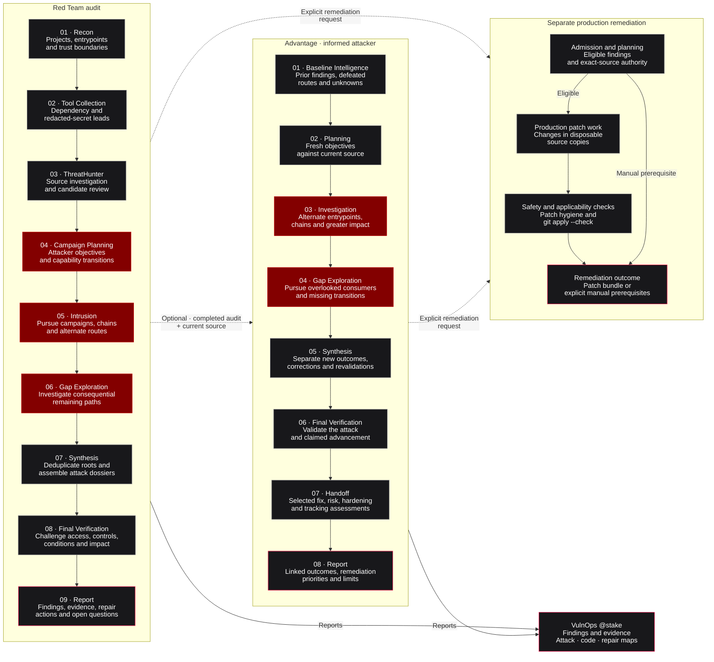

  

# VulnOps V5.X

VulnOps is a **Red.Team audit platform** that turns application security assessments into defensible remediation priorities. It conducts coordinated intrusion campaigns across application codebases, establishes viable attack paths and their impact, and delivers independently reviewed findings with precise recommendations for code and control changes // **the actions that break the attack path**

**Advantage** extends this work through informed-attacker investigation, using prior assessment intelligence to identify additional routes to compromise. **VulnOps @stake** brings the evidence and repair guidance into a single workspace, connecting security decisions with the files, controls and implementation steps engineering needs to address them.

Dashed links require a separate request. The Advantage lane shows investigation modes; actions-only proceeds from Baseline to Handoff and Report. 

Remediation boxes show the steps within its separate workflow; patches are not automatically applied or tested.

| Workflow | Use it for | Entry point |
|---|---|---|
| Ordinary audit | Assess an application or resume unfinished work | `./run.sh` |
| Advantage | Investigate further using a completed audit as intelligence | `./advantage.sh` |
| Remediation | Generate production patches in a separate execution | `./remediate.sh` |
| VulnOps @stake | Explore completed reports, code references and repair instructions | [Viewer guide](stake/README.md) |

V5 is the product version; artifacts use schema `2.0` under `schemas/v2/`.

V5 is an AI-driven security audit platform that investigates application code from an attacker’s perspective. It traces how weaknesses combine into paths to compromise, challenges those paths through independent review, and connects supported findings to the code and controls that need to change. Each finding explains the attacker’s starting access, the conditions required, the potential impact, and **the actions that break the attack path** // giving engineering teams evidence to prioritize and implement repairs, not just a list of findings.

License: [FSL-1.1-ALv2](LICENSE). Copyright 2026 xfhg. 

Each version receives an
additional Apache 2.0 license two years after it is made available.
