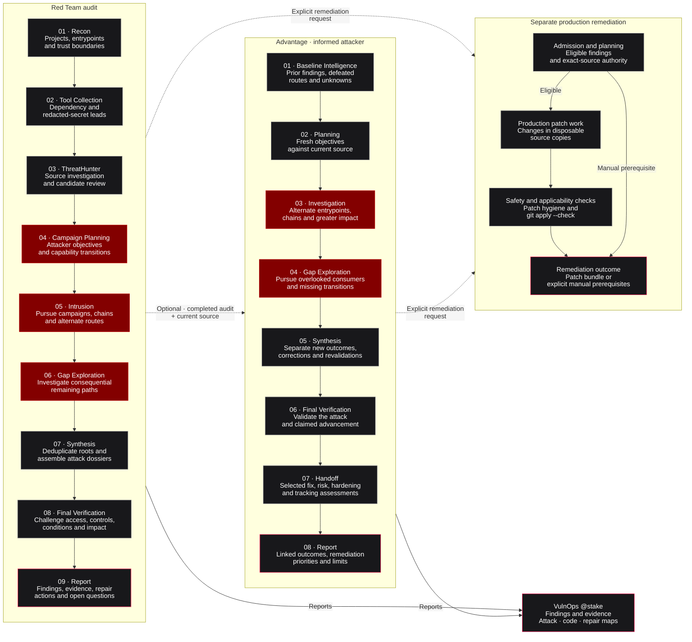

<p align="center">
  
</p>

# VulnOps V5

VulnOps is a **Red Team audit platform** that turns application security
assessments into defensible remediation priorities. It conducts coordinated
intrusion campaigns across application codebases, establishes viable attack paths
and their impact, and delivers independently reviewed findings with precise
recommendations for code and control changes.

**Advantage** extends this work through informed-attacker investigation, using
prior assessment intelligence to identify additional routes to compromise.
**VulnOps @stake** brings the evidence and repair guidance into a single workspace,
connecting security decisions with the files, controls and implementation steps
engineering needs to address them.



Dashed links require a separate request. The Advantage lane shows investigation
modes; actions-only proceeds from Baseline to Handoff and Report. Remediation
boxes show the steps within its separate workflow; patches are not automatically
applied or tested.

| Workflow | Use it for | Entry point |
|---|---|---|
| Ordinary audit | Assess an application or resume unfinished work | `./run.sh` |
| Advantage | Investigate further using a completed audit as intelligence | `./advantage.sh` |
| Remediation | Generate production patches in a separate execution | `./remediate.sh` |
| VulnOps @stake | Explore completed reports, code references and repair instructions | [Viewer guide](stake/README.md) |

## Prepare the runtime

Source installations support **macOS ARM64** and **Linux AMD64**, with Bash, Git
and Python **3.11+**. Install the pinned tools and advisory snapshot online:

```bash
bash scripts/install-tools.sh
bash scripts/fetch-osv-db.sh
cp config.toml.example config.toml
```

Edit `config.toml` for your provider, authentication and model routes. All twelve
routing groups are required; [the template](config.toml.example) documents them.
Regenerate the contained OMP configuration after changes:

```bash
bash scripts/bootstrap-omp.sh
# Native OMP OAuth login; omit the provider to choose interactively:
./run.sh login openai-codex
```

Login reuses OMP's persistent store under `.harness/home/.omp/agent`, separate
from global OMP credentials; OMP owns token refresh. Login, `--help` and `--version`
do not require audit readiness. `run.sh` uses `bins/omp` and has no CA import,
discovery or validation logic.

Place one application under `target/`, as one Git repository or multiple component
repositories. The harness treats their source as read-only. You can clone during
preparation, then check readiness:

```bash
bash scripts/clone-target.sh <repository-url> [branch] [directory]
bash scripts/validate-config.sh
```

Repeat cloning with distinct directories for components. Startup does not install
tools, refresh databases or clone source. `validate-config.sh --offline` checks
installation without testing live provider readiness. For transferable packages
and their `setup.sh` commands, use [offline.md](offline.md).

## Run an assessment

### Ordinary audit

```bash
./run.sh "audit the target application at balanced depth"
./run_local.sh --fresh "audit the target application at balanced depth"
```

Without `--fresh`, the launcher resumes valid incomplete work. `--fresh` starts
a new audit without deleting previous evidence. Depths are `quick`, `balanced`
and `full`; the default is `balanced`. With no prompt, the launcher opens OMP
without requesting an audit.

`run.sh` uses contained authentication. `run_local.sh` reuses a global OMP login
or an inherited `OPENAI_CODEX_OAUTH_TOKEN`; the temporary-token handoff does not
provide automatic OAuth refresh. It uses default TLS trust unless you supply a
readable `NODE_EXTRA_CA_CERTS` file.

```text
Recon → Tool Collection → ThreatHunter → Campaign Planning → Intrusion
      → Gap Exploration → Synthesis → Final Verification → Report
```

### Advantage

Advantage uses a completed ordinary audit as historical intelligence and assesses
current source. Each explicit invocation starts fresh. Defaults are **deep/full**;
mode and depth can be overridden independently.

```bash
./run_local.sh --advantage <completed-audit-base>
./advantage.sh <completed-audit-base> --mode standard --depth balanced
./advantage.sh <completed-audit-base> --mode diff --patch change.patch
```

`standard` runs one informed pass; `deep` uses independent passes within one shared
allocation. `diff` assesses immutable patch bytes in disposable source views.
Use `--source-root PATH` to select source and `--repository KEY` to bind a patch
to its repository. Inside an existing prepared OMP session, request Advantage
with the completed audit path or exact unique run ID; do not launch another OMP.
Only one workflow may be active.

Follow-on assessments use a separate actions-only invocation:

```bash
./advantage.sh <completed-audit-base> --mode actions \
  --action-source <completed-advantage-base> --patch fix.patch \
  --verify-fix F-001 --assess-patch-risk --hardening --track-finding F-001
```

Choose only the flags you need. The action source must be a completed non-actions
Advantage assessment linked to that baseline. Fix verification and patch-risk
review require a patch; tracking alone does not. Actions produce assessments,
hardening proposals or sanitized offline handoffs. They do not discover new
findings, apply fixes, approve merges or publish external issues.

### Production remediation

```bash
./remediate.sh <completed-audit-or-advantage-base>
```

This separate Blue workflow generates patches under `remediations/` using
disposable `work/` copies. Automated patching requires one repository and
supported exact-source authority; other inputs receive manual prerequisites.
Patches pass safety and `git apply --check` gates. The workflow does not execute
tests, apply patches, commit or push them.

## Read reports with VulnOps @stake

The viewer connects findings, attack paths, code references and repair guidance.
It supports two runtimes:

- **Browser:** drop one ZIP containing an ordinary run and an Advantage run.
  The viewer validates both before replacing the workspace and stores the ZIP in
  browser IndexedDB. An empty workspace opens on a black overview. No report
  service or absolute folder paths are needed.
- **Local CLI:** serve report folders from this checkout. Settings can replace
  and remember the two paths; explicit `--run` arguments take precedence.

For the CLI, install Node.js **22.12+**, npm and Python **3.11+**, then run:

```bash
npm --prefix stake ci
npm --prefix stake run build
npm --prefix stake start -- serve --run "/path/to/ordinary-run" --run "/path/to/advantage-run"
```

Omit `--run` to use setup or remembered paths. The server opens an available
loopback port. Build the standalone browser viewer with
`npm --prefix stake run build:web`. See [the viewer guide](stake/README.md) for
ZIP layout, storage, evidence and repair navigation, and [SITES.md](stake/SITES.md)
for private deployment. Actions-only reports are not supported by the viewer.

## Outputs and interpretation

Completed assessments publish `report/security-report.md` and
`report/security-report.json` under `scans/<repo-id>/runs/<run-id>/`, with complete
findings in `final-verification/findings.json`. Deliver the sanitized canonical
run tree with referenced evidence, not Markdown alone. Exclude target source,
runtime state, credentials, raw scanner/proof output and recovery archives.
Completed evidence is immutable; publication time is separate from assessed scope.

```bash
bash scripts/audit-status.sh <audit-base>
bash scripts/advantage-status.sh <advantage-base>
bash scripts/remediation-status.sh <remediation-base>
```

- Source-established behavior is distinct from executed reproduction. Optional
  reproduction requires Linux and working Bubblewrap containment; it is off by default.
- Fresh-context review is not necessarily model diversity. Default investigation
  and verification use the same Red model; reports retain actual attribution.
- Zero confirmed findings is not clean coverage. Unresolved, rejected and
  environment-required claims remain separate; overlapping counts are not unique issues.
- Repair guidance and apply-checks do not prove a fix works or is regression-free.
- Default `policy_only` egress is not an OS network sandbox. Analysis sends needed
  prompt/source context to the configured LLM provider; live target probing is excluded.

## Documentation

| Guide | Contents |
|---|---|
| [WORKFLOWS.md](WORKFLOWS.md) | Phase overview and workflow selection |
| [AGENTS.md](AGENTS.md) | Canonical operational runbook and agent ownership |
| [ARCHITECTURE.md](ARCHITECTURE.md) | Design, evidence boundaries and recovery contracts |
|                                            |                                                    |
| [config.toml.example](config.toml.example) | Configuration, routing and budgets |
| [.omp/skills/](.omp/skills/) | Native security methodology and Advantage skills |
| [stake/README.md](stake/README.md) | Report viewer setup and use |

---

License: [FSL-1.1-ALv2](LICENSE). Copyright 2026 xfhg. 
